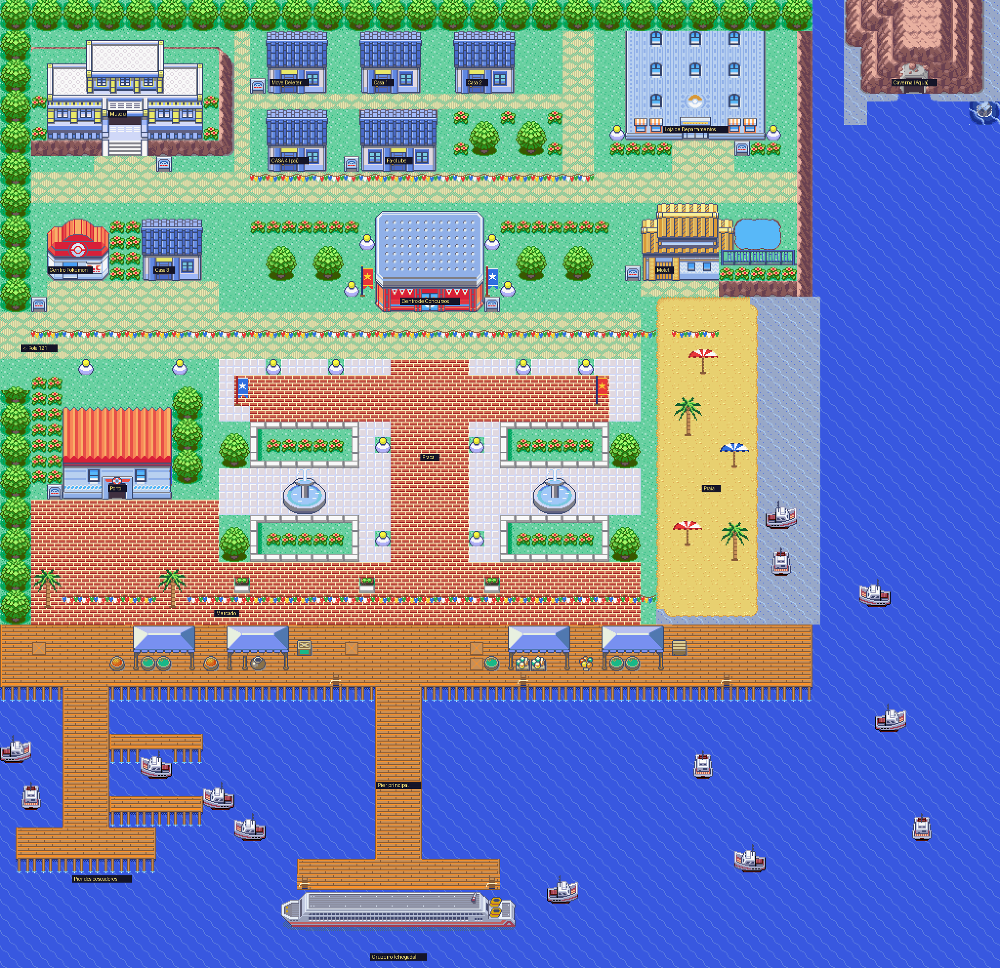

# Nova Lilycove — reformulação do mapa



Mapa `LAYOUT_LILYCOVE_CITY` refeito do zero (64×52 tiles, antes 80×40), inspirado na
imagem de referência: centro de concursos no eixo central, praça com fontes, bairro
residencial ao norte, orla com cais ao sul e praia a leste.

## Zonas

| Zona | Posição (x,y da porta) | Observação |
|---|---|---|
| Museu | (7,7) e (8,7) | Platô com escadaria, canto noroeste |
| Bairro residencial | Move Deleter (18,5), Casa 1 (24,5), Casa 2 (30,5) | Fileira norte |
| **Casa 4 (casa do pai)** | (18,10) | Residência do protagonista no roteiro |
| Fã-clube | (25,10) | |
| Loja de Departamentos | (44,8) | Prédio alto no canto nordeste |
| Casa 3 | (10,17) | |
| **Centro de Concursos** | (27,19) | No eixo central, com jardins e postes |
| Motel Cove Lily + piscina | (42,17) | Acima da praia |
| Porto (SS Tidal) | (7,31) | Com píer próprio |
| Praça das Fontes | y 23–35 | Três fontes, canteiros floridos |
| Orla / píer central | y 36–47 | Muro de contenção, píeres, navio e barcos (objetos decorativos) |
| Praia | x 42–51, y 19–41 | Areia → água rasa → mar. Barcos de pesca do pai |
| Caverna (Aqua) | (58,5) | Ilhota no mar, só por Surf (mantém o warp original) |

## Conexões
* **Rota 121** a oeste: avenida principal nas linhas y 20–23 (offset 15 / −15).
* A conexão com a **Rota 124** foi removida (o jogo usa só Lilycove + Rota 121).

## Compatibilidade preservada
* A ordem dos 14 warps foi mantida, portanto todos os interiores continuam voltando
  para a porta certa sem alterações.
* Ponto de cura (`heal_locations.json`) e `setescapewarp` do Porto foram atualizados.
* Todos os NPCs, placas e itens escondidos originais foram reposicionados em tiles
  válidos (os scripts antigos continuam funcionando até serem reescritos).

## Como editar
```
python3 dev_scripts/lilycove_redesign/build_lilycove.py --preview /tmp/lilycove.png
```
Edite `dev_scripts/lilycove_redesign/layout.py` (funções `house`, `contest`, `pond`,
`path`, `trees`, `lamp`…) e rode de novo; o script regrava `map.bin` e gera a prévia.
Se mover prédios, atualize as coordenadas em `data/maps/LilycoveCity/map.json`.

## Atmosfera da Temporada Mundial de Concursos
Tiles novos no tileset secundário de Lilycove (gerados por
`dev_scripts/lilycove_redesign/festival_tiles.py`, usando as paletas 6 e 12, que
estavam vazias):

| Elemento | Onde aparece |
|---|---|
| Piso de tijolo vermelho | Praça das Fontes, orla e frente do Porto |
| Calçadão e píeres de madeira (pranchas, vigas, estacas na água, caixotes e postes de amarração) | Toda a orla sul, píer central e píer dos pescadores |
| Tapete vermelho | Da porta do Centro de Concursos até a fonte central |
| Bandeirolas (vermelho/azul) | Avenida, rua norte, borda da praça e orla |
| Estandartes da temporada | Ao lado do Centro de Concursos e nos cantos da praça |
| Guarda-sóis (vermelho/azul) e palmeiras | Praia; palmeiras também na orla |

Uso: 499/512 tiles e 418/512 metatiles do tileset secundário.

`vivid_palettes.py` aumenta a saturação (+22%) e o brilho (+4%) das paletas externas
(General 0–5 e Lilycove 7–11). Os originais ficam em `base_tileset/`, e os dois
scripts podem ser rodados de novo sem acumular o efeito.

Ordem para regenerar tudo:
```
python3 dev_scripts/lilycove_redesign/festival_tiles.py
python3 dev_scripts/lilycove_redesign/vivid_palettes.py
python3 dev_scripts/lilycove_redesign/build_lilycove.py --preview /tmp/lilycove.png
```

## Bairro residencial 1 (oeste)
O mapa ganhou 16 colunas a oeste e 8 linhas ao norte (agora 80×70).
* **Rua de pedra** (3 tiles) subindo do calçadão do porto até o **Museu**, que foi para o
  topo do morro, com um pátio de ladrilho na frente da escadaria.
* Lado oeste, de baixo para cima: Residência Coral (moderna, porta para o calçadão),
  Edifício Brisa do Mar (apartamentos modernos), **degrau de terreno com escada de 3
  tiles** alinhada com a rua, Casa Ventura, Edifício Lilás e Casa Neves.
* A Casa Neves e as **3 casas do L** (Casa 3, Residência Lírio e Residência Aurora) ficam
  na mesma linha, acima da rua norte, com 3 tiles de jardim entre elas, quintais com
  árvores e flores atrás e cercas baixas na frente.
* Lotes separados por cercas, jardins laterais com flores; o antigo terreno do L virou um
  jardim do bairro. As árvores que cortavam o degrau foram removidas.
* **Trilhas de terra com borda suave** (autotile de areia do Emerald) ligando cada porta à rua.
* **Postes modernos** ao longo da rua residencial.
* Junção com a Rota 121: o GBA desenha o mapa vizinho com o tileset do mapa atual. Por
  isso a faixa x 0–8 / y 11–33 (vista a partir da rota) usa só peças compartilhadas (casas
  clássicas, flor vermelha original, cercas, ladrilho compartilhado). Testado nos dois sentidos.

## Praça (em frente ao Centro de Concursos)
* Contorno e caminhos em **ladrilho cinza** (desenhado na paleta 8 de Lilycove).
* **Cruz invertida de tijolos**: braço longo no eixo do Centro de Concursos, indo até o
  calçadão, e travessa logo abaixo do prédio.
* **Tijolos** simplificados e menos saturados (pedras grandes com junta suave).
* Dois **gramados** simétricos, cheios de flores em cinco cores (variações recoloridas da
  flor original do Emerald), árvores nos cantos e um canteiro longo com meio-fio branco.
  As **fontes modernas** (piscina retangular com três jatos) ficam centralizadas nos
  gramados e espelhadas em relação ao eixo da praça.
* **Postes modernos** (haste fina, braço e luminária de LED), nas mesmas posições de
  antes, com as cabeças voltadas para o caminho. As **bandeirinhas** ficam presas entre
  as cabeças dos postes.
* A praça vai da avenida até o calçadão do porto (o píer não mudou).

## Porto (zona sul)
Arte no estilo do próprio Emerald, extraída dos gráficos originais por
`authentic_art.py` (fundo removido e cores reunidas em duas paletas próprias da cidade,
slots 10 e 11):
* **Cruzeiro**: o sprite do S.S. Tidal alongado (seção de janelas repetida), atracado na
  plataforma horizontal do píer principal (hoje como sprite, ver abaixo). É onde o protagonista desembarca.
* **Barcos pesqueiros**: o barco do Mr. Briney (lateral, espelhado e de frente),
  espalhados pela baía, no píer dos pescadores e na água rasa da praia.
* **Mercado**: tendas e mercadorias do mercado de Slateport (cestos, potes, frutas,
  flores, caixotes) ao longo do calçadão.
* Calçadão e píeres de madeira em tom mais claro, ligados à praia.

O mapa agora tem 80×70. A cidade usa um tileset só dela, `gTileset_LilycoveCity`,
gerado por `build_city_tileset.py`. Ele mantém os ids de metatile que a cidade já usava
(as animações de porta continuam funcionando) e reaproveita o espaço que só servia à
Rota 121 e ao Safari. Tiles iguais ou espelhados são reaproveitados (espaço livre: ver abaixo).

## Hotel Litoral
* **Prédio** montado a partir do exemplo do usuário (`hotel_ref.png`): telhado de deck, duas alas
  com janelões e base com friso, torre central de vidro curvo e entrada com porta dupla. Limpeza em
  `hotel_art.py`: transparência binária, 15 cores, contorno escuro uniforme na silhueta, pixels
  soltos removidos e porta centrada numa divisa de tiles.
* 14×12 tiles, desenhado como **sprite** (paleta própria `lilycove_hotel.pal`), dividido em blocos
  de até 5×4 tiles para não surgir na borda da tela. Colisão no mapa; as duas folhas da porta são
  tiles de porta sem animação ligados ao interior do antigo Motel (cada folha volta pela sua).
* O mapa ganhou 4 linhas ao norte (agora **94×74**) para o prédio caber com a floresta atrás;
  eventos, conexão com a Rota 121, ponto de cura e warps dos scripts foram deslocados.
* **Lote**: cerca azul de Lilycove (portão no fim da rua norte), piscina grande com deck, pátio
  de entrada, palmeiras e árvores dos lados e fileira de palmeiras junto à praia.
* Para caber no limite de 64 objetos por mapa, 3 barcos distantes da baía foram removidos.
* A **estrada de areia** desce ao lado do lote por uma escada de 3 tiles; placa
  "Praia de Lilycove / Hotel Litoral (em obras)".

## Praia (leste)
O mapa ganhou 14 colunas a leste (agora 94×70).
* **Orla natural e horizontal**: a areia desce até o calçadão no oeste e a linha d'água corre
  na horizontal para o leste, com ondulações suaves e ponta leste arredondada. O terreno é
  decidido por cantos (areia / água rasa / mar) e cada tile usa a peça de borda do Emerald que
  combina com os 4 cantos, as mesmas da praia original de Lilycove; faixa larga de água rasa.
* **Platô do hotel ao norte** (reservado para a arte do hotel): a Loja antiga e o Motel foram
  removidos; o platô vai da rua norte até a ponta leste, com falésia na divisa com a praia e
  floresta atrás. O warp do Motel ficou estacionado no platô para o futuro hotel.
* **Praça → praia sem faixa de grama**: o ladrilho da praça encosta direto na areia.
* **Adereços**: palmeiras e **conjuntos de guarda-sol da Rota 109 com
  espreguiçadeiras** (sprites, sombra pontilhada na areia).
* `overview.py` gera o mapa completo com os sprites (`docs/lilycove/mapa_geral*.png`).

## Shopping (Loja de Departamentos)
Ocupa o quarteirão inteiro entre a rua norte e a avenida, acima do café.
* **Telhado plano** (4 linhas) com as peças do telhado do Centro de Concursos original (repetidas na
  horizontal, sem custo de tiles), com a **Pokébola** na frente do telhado.
* Fachada com as **peças originais da Loja de Departamentos de Lilycove**, alongada para 18
  tiles: faixa com **bandeirolas** e a **faixa de LED "POKEMON CONTEST"** (o telão), **vitrines
  com toldo** e **duas portas duplas de vidro** (cada folha é uma porta animada).
* Na calçada, **tapetes vermelhos horizontais** pequenos diante de cada porta, ladeados por
  palmeirinhas em vaso.
* As 4 folhas levam à loja; a saída da direita volta pela porta da direita. Placa da loja
  na calçada. O prédio antigo (bairro norte) ficou com a porta trancada até ser redesenhado.
* Espaço: a Pokébola está no tileset primário; sobram 4 tiles na cidade e 4 no primário.

### Bicicletário
No canteiro entre a avenida e o degrau, em frente ao shopping: dois grupos de bicicletas
estacionadas (amarelas, azuis e vermelhas, da vitrine da loja de bicicletas de Mauville),
com canteiros de flores nas pontas.

## Decorações como sprites
`decor_sprites.py` transforma decorações em object events (como o navio): guarda-sóis com
mesa e cadeiras, mesinhas do café e todas as barracas (calçadão e barraca de flores). No
layout, `decor(nome, x, y, walk_rows)` marca a colisão do chão e registra o sprite; o build
gera os gráficos (`graphics/object_events/pics/misc/lc_*.png`), a paleta
`lilycove_decor.pal`, `src/data/object_events/lilycove_decor.h` e os objetos no `map.json`.
No máximo 10 objetos ficam ativos numa mesma tela (limite 16). Espaço livre agora: ~56
tiles e ~148 metatiles na cidade.

## Café Litoral (bairro 1, beira do calçadão)
Substitui o Centro Pokémon e o prédio do Porto. Montado com peças do próprio Emerald:
* **Café**: a floricultura da Rota 104 (telhado laranja levemente escurecido, toldo
  listrado), com paredes creme, revestimento de madeira no lugar das floreiras, pilares
  claros e uma boia salva-vidas na parede.
* **Terraço de madeira fosca** (tom médio, juntas suaves, na paleta 10), até o poste da rua,
  **cercado** por cerca baixa marrom nos três lados, com entrada alinhada à porta do café.
* **Mesinhas redondas modernas** (desenhadas no estilo do jogo) com **duas cadeiras
  vermelhas do lounge da Battle Frontier**, e conjuntos de **guarda-sol da praia da Rota
  109** sobre mesa e cadeiras (o mastro entra no centro da mesa; sombra pontilhada).
* **Palmeirinhas em vaso** (também do lounge da Battle Frontier) organizadas em pares:
  ladeando o café e a entrada do terraço; mais duas no calçadão.
* **Máquinas de bebida** do terraço da Loja de Departamentos (água, limonada e soda, cada
  uma com garrafas de uma cor), com o script original de compra; **cerca baixa marrom** com entrada alinhada à
  porta, calçada ligando a rua à praça e piso cinza até o calçadão, com barraca de flores.
* Café, móveis e guarda-sóis na paleta 11 do mercado (o índice 6, que estava livre, virou
  um vermelho-coral); piso na paleta 10 (duas entradas livres viraram madeira fosca); vasos e cerca na 6.
* Placas: letreiro do café e aviso na porta.
* O Centro Pokémon e o Porto saíram do mapa. Os warps deles ficam na calçada, para
  que o renascimento depois de desmaiar e o Fly continuem funcionando, até o Centro
  ganhar um lugar novo.

## Orçamento de tiles: sprites, peças genéricas e variações por paleta
* **Cruzeiro e barcos são sprites** (object events), como o S.S. Tidal e o barco do
  Mr. Briney no jogo original. O cruzeiro é dividido em 4 segmentos de 64×48
  (`OBJ_EVENT_GFX_CRUISE_SHIP_0..3`, paleta do S.S. Tidal) para não "surgir" na borda da
  tela; os 13 barcos usam o gráfico original do Mr. Briney (`OBJ_EVENT_GFX_MR_BRINEYS_BOAT`).
  No máximo 9 desses objetos ficam ativos numa mesma tela (limite do jogo: 16).
* **Peças genéricas no tileset primário** (`gTileset_General`): ladrilho de pedra, flores
  coloridas, postes modernos e bandeirinhas. Ficam em tiles vazios (fora das áreas
  animadas) e em metatiles que nenhum mapa usa. Não gastam espaço da cidade e aparecem
  certas também a partir da Rota 121. O `build_city_tileset.py` reconstrói o primário a
  partir da cópia original em `base_tileset/general`.
* **Variações por paleta**: o slot 10 (liberado pelo navio) é uma cópia da paleta das
  casas modernas com outras cores. Residência Coral (telhado coral) e Residência Lírio
  (lilás) usam os mesmos tiles das casas cinza e bege: custo zero em tiles.
* Espaço livre agora: ~114 tiles e ~129 metatiles na cidade; 16 tiles e 10 metatiles
  reservados no primário.

## Próximos passos
* Interior da Casa 4 (sala, cozinha, quarto extra) conforme o roteiro.
* Abertura: comercial, formulário de inscrição, cabine e chegada ao porto.
